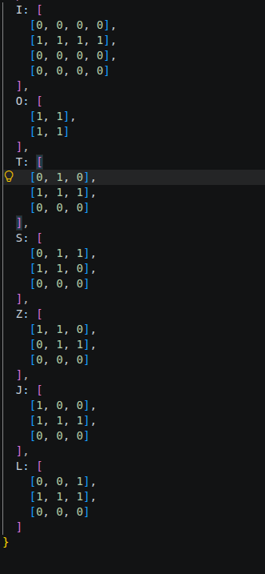

# L’IA dans l’IDE : VS Code et GitHub Copilot
## Exercice 1 - Prise en main : chaque outil à sa place
Utiliser une fois chaque outil de Copilot sur une tâche minuscule dont le résultat se vérifie, pour savoir ensuite lequel choisir.
1. Complétion (3)

2. Complétion (3)
La vérification dans le terminal renvoie une réponse correcte
3. Chat en ligne
Slection de : 
```
export function rotate(matrix) {
  const N = matrix.length;
  const result = Array.from({ length: N }, () => Array(N).fill(0));
  for (let i = 0; i < N; i++) {
    for (let j = 0; j < N; j++) {
      result[j][N - 1 - i] = matrix[i][j];
    }
  }
  return result;
}
```
_Prompt_ : lève une erreur si la matrice n’est pas carrée
Suite au diff : 
```
export function rotate(matrix) {
  const N = matrix.length;
  if (!Array.isArray(matrix) || matrix.some(row => !Array.isArray(row) || row.length !== N)) {
    throw new TypeError('La matrice doit être carrée.');
  }
  const result = Array.from({ length: N }, () => Array(N).fill(0));
  for (let i = 0; i < N; i++) {
    for (let j = 0; j < N; j++) {
      result[j][N - 1 - i] = matrix[i][j];
    }
  }
  return result;
}
```
4. Chat en ligne
_Prompt_ :#file :src/core/piece.js quelle convention d’orientation utilisent ces matrices, et quelle forme est incorrecte ?
_Réponse_ : Dans `piece.js`, les matrices sont lues **ligne par ligne, de haut en bas** : `1` indique une case occupée, `0` une case vide. L’orientation initiale est celle représentée par chaque matrice, et `rotate` la fait tourner d’un quart de tour **dans le sens horaire** — cohérent avec des coordonnées d’écran où les lignes augmentent vers le bas.
Je ne vois **aucune forme incorrecte** : les sept matrices correspondent aux tétriminos standards, y compris les formes miroir `S`/`Z` et `J`/`L`.\
La réponse donnée dans le chat correspond à ma vérification effectuée dans l'étape 1.
5. Terminal
_Prompt_: initialise npm et installe vitest en dépendance de développement\
_Réponse_ : npm init -y && npm install --save-dev vitest
6. Agent
_Prompt_: crée tests/piece.test.js avec trois tests de rotate (matrice 2x2, matrice
3x3, matrice non carrée qui doit lever une erreur), puis lance les tests\
_Réponse_ : Créé piece.test.js avec les trois tests demandés : rotation d’une matrice 2×2, rotation d’une matrice 3×3 et erreur pour une matrice non carrée. Résultat : les 3 tests passent.

_Prompt_: \
_Réponse_ :